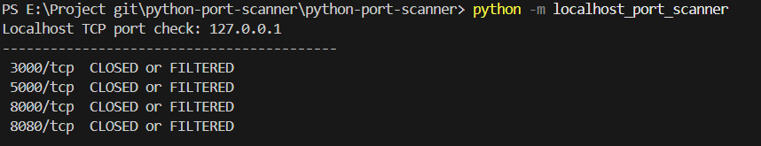

# Python Port Scanner — Localhost Learning Edition

A small Python CLI project that checks whether selected TCP ports accept a connection on **your own computer only**. It demonstrates socket programming, input validation, error handling, and unit testing.

> **Safety scope:** The program accepts loopback IP addresses only (`127.0.0.1` and `::1`). It rejects hostnames and non-loopback destinations. It is not designed for scanning public IPs, websites, or other people's devices.

## Features
- Checks an explicit list of TCP ports on localhost.
- Supports IPv4 and IPv6 loopback.
- Maximum 20 ports per run.
- Validates ports and timeout.
- Closes sockets reliably.
- Unit tests mock socket operations.
- Uses Python standard library only.

## Requirements
- Python 3.10+
- No third-party runtime dependencies

## Structure
```text
python-port-scanner/
├── README.md
├── LICENSE
├── .gitignore
├── pyproject.toml
├── src/localhost_port_scanner/
│   ├── __init__.py
│   ├── __main__.py
│   ├── cli.py
│   └── scanner.py
└── tests/test_scanner.py
```

## Install and run
```bash
python -m pip install -e .
python -m localhost_port_scanner
```

Select a few ports on localhost:
```bash
python -m localhost_port_scanner --host 127.0.0.1 --ports 3000,8000,8080
```

IPv6 loopback:
```bash
python -m localhost_port_scanner --host ::1 --ports 8000,8080
```

## Run tests
```bash
python -m unittest discover -s tests -v
```
Tests use mocked sockets and do not scan network hosts.

## Example output



Note: This tool checks loopback addresses only.
```
Actual results depend on local services. `CLOSED or FILTERED` means a connection was not successful; this simple tool cannot distinguish the exact cause.

## Limitations
- TCP only; no UDP support.
- Does not identify services or versions.
- Checks connection acceptance only.
- Deliberately restricted to loopback addresses.

## Learning outcomes
- Python TCP sockets
- Connection success and failure
- Input validation
- Python package organization
- Unit testing with mocks

## Responsible use
For education and local testing on systems you own. The code enforces loopback-only destinations. Do not modify it to target systems without explicit authorization.
